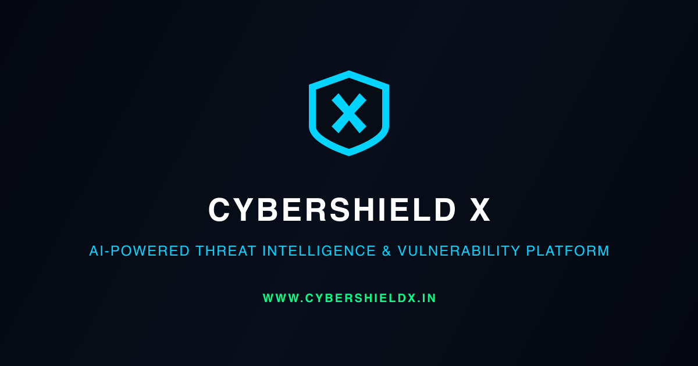

# <p align="center"></p>

<h1 align="center" style="font-family: 'Orbitron', sans-serif; font-size: 2.8rem; font-weight: 900; letter-spacing: 2px;">
  CYBERSHIELD X 🛡️
</h1>

<p align="center">
  <b>Next-Generation Autonomous Threat Intelligence, Interactive CyberSOC Workstation & Multi-Cloud Security Ecosystem</b>
</p>

<p align="center">
  <a href="https://www.cybershieldx.in"></a>
  <a href="https://www.cybershieldx.in/terminal"></a>
  <a href="https://www.cybershieldx.in/dashboard"></a>
  <a href="https://cybershield-x.onrender.com/health"></a>
  <a href="https://www.cybershieldx.in"></a>
  <a href="#-mit-license"></a>
</p>

<p align="center">
  <a href="https://www.cybershieldx.in"><b>🌐 Live Platform</b></a> •
  <a href="https://www.cybershieldx.in/terminal"><b>💻 CyberSOC Terminal</b></a> •
  <a href="https://www.cybershieldx.in/team"><b>👥 Core Team</b></a> •
  <a href="https://cybershield-x.onrender.com/health"><b>⚡ Health Telemetry</b></a> •
  <a href="#-system-architecture"><b>📐 Architecture</b></a> •
  <a href="#-125-canonical-security-tools--24-domains"><b>🧰 Tools Registry</b></a> •
  <a href="#-quickstart--local-development"><b>🚀 Quick Start</b></a>
</p>

---

## ⚡ Executive Summary

**CyberShield X** is a production-grade, full-stack cybersecurity operations platform engineered for Security Operations Centers (SOC), Red/Blue Teams, DevSecOps professionals, and security researchers.

Built on a zero-trust, defense-in-depth philosophy, CyberShield X fuses **live CISA exploit monitoring**, an authoritative **125-tool operational security registry**, a sandboxed **host-native diagnostic terminal**, a **resilient dual-model AI Copilot (CyberBot)**, and a **multi-cloud event normalization fabric** into a unified, high-performance cyber command center.

```
┌────────────────────────────────────────────────────────────────────────┐
│                        CYBERSHIELD X AT A GLANCE                       │
├────────────────────────────────────────────────────────────────────────┤
│  • 125 Canonical Security Tools across 24 Specialized Domains          │
│  • Real-Time CISA KEV Live Exploit Stream with 15-Min Cache Proxy      │
│  • Subprocess-Sandboxed Interactive CyberSOC Terminal (/terminal)      │
│  • 7 Automated Multi-Vector Offensive & Defensive SOC Playbooks        │
│  • Resilient Multi-Model AI Copilot (Gemini 2.5 Flash ➔ 3.8 Flash)     │
│  • Normalized Multi-Cloud Ingestion (AWS CloudTrail, GCP, Azure)       │
│  • Enterprise ITSM & SOAR Dispatch (Jira, ServiceNow, PagerDuty)       │
│  • Quantum Vault with Authenticated AES-256-GCM Encryption             │
└────────────────────────────────────────────────────────────────────────┘
```

---

## 🌐 Current Production Status & Topology

| Infrastructure Tier | Provider / Technology | Target / Configuration | Verified Status |
| :--- | :--- | :--- | :---: |
| **Edge Presentation** | Cloudflare Pages | `https://cybershieldx.in` • `https://www.cybershieldx.in` | `HTTP/2 200 OK` |
| **Edge Backup CDN** | Cloudflare Pages Direct | `https://cybershield-x.pages.dev` | `HTTP/2 200 OK` |
| **Backend API Gateway** | Render Web Service | `https://cybershield-x.onrender.com` | `HTTP 200 OK` |
| **Health Telemetry** | Express Health Probe | `https://cybershield-x.onrender.com/health` | `CONNECTED` |
| **Database Cluster** | MongoDB Atlas | Production Multi-Region Replica Set (Mongoose 8) | `ACTIVE` |
| **CISA Threat Feed** | CISA KEV Catalog API | `GET /api/threat-feed` (15-min in-memory cache) | `LIVE FEED` |
| **CyberSOC Terminal** | Node.js Subprocess Sandbox | `https://www.cybershieldx.in/terminal` (`shell: false`) | `ONLINE` |
| **Core Team Portal** | Standalone Cyber Hub | `https://www.cybershieldx.in/team` | `ONLINE` |

---

## 📐 System Architecture

CyberShield X enforces a decoupled client-server architecture with strict separation of concerns, the Repository Pattern, and defense-in-depth isolation:

```
┌────────────────────────────────────────────────────────────────────────┐
│                      Global Edge Tier (Cloudflare)                     │
│        https://www.cybershieldx.in • https://cybershield-x.pages.dev   │
│                 Full Strict TLS 1.3 • Global Anycast Edge              │
└───────────────────────────────────┬────────────────────────────────────┘
                                    │ HTTPS / WSS
                                    ▼
┌────────────────────────────────────────────────────────────────────────┐
│                    Frontend Tier (React 18 SPA)                        │
│  • HomePage: CISA KEV Live Marquee, HIBP Gateway, Matrix Rain Canvas   │
│  • Dashboard: 125 Canonical Tool Cards, 24 Categories, Welcome Modal   │
│  • CyberSOC Terminal: Standalone Host-Native Console (/terminal)       │
│  • CyberBot Copilot: Resilient Multi-Model AI with Restored HD Avatar   │
│  • Core Team Hub: Standalone Team Roster & Clearance Workstation       │
│  • Auth: Universal 3-Way Login (Username / Email / Phone + Password)   │
└───────────────────────────────────┬────────────────────────────────────┘
                                    │ REST API over TLS / Socket.IO
                                    ▼
┌────────────────────────────────────────────────────────────────────────┐
│             Backend API Tier (Node.js Express on Render)               │
│  • Gateway & Security: Helmet, Strict Origin CORS, SSRF DNS-Pinning    │
│  • Thin Controllers: auth, threatFeed, terminal, toolkit, chatbot      │
│  • Domain Services: AIOrchestrator, ThreatFeedService, BreachService   │
│  • Terminal Sandbox: child_process.spawn(shell: false) + 10s Watchdog  │
│  • SOAR Engine: In-Memory Integration Dispatcher with DLQ & Retries    │
└───────────────────────────────────┬────────────────────────────────────┘
                                    │ TLS 1.3 Mongoose ODM
                                    ▼
┌────────────────────────────────────────────────────────────────────────┐
│                   Data & External Intelligence Tier                    │
│  • MongoDB Atlas: Multi-Tenant Schemas, Non-Repudiable Audit Logging   │
│  • CISA KEV Catalog: Automated Exploit Feed with 15-Minute Cache Proxy │
│  • Google Gemini: Dual-Model Hierarchy (2.5 Flash ➔ 3.8 Flash)        │
│  • Enterprise ITSM: Jira, ServiceNow, PagerDuty, Slack, Teams Webhooks │
└────────────────────────────────────────────────────────────────────────┘
```

---

## 🌟 Core Platform Pillars

### 1. 🧰 125 Canonical Security Tools Across 24 Domains
An exhaustive, standardized security intelligence and testing catalog spanning every modern cyber discipline:
* **55 ONLINE Tools**: Direct browser-based scanners and diagnostic interfaces (SSL Labs, MXToolbox, Shodan, Port Scanners, DNS Enumeration, Breach Detection, CISA KEV, EPSS, CloudShark, crt.sh).
* **70 COMING_SOON Tools**: Curated native and enterprise tools with direct references to official repositories and secure alternative advisory modals.
* **Zero Misleading CTAs**: Absolute invariant — external tools link strictly to verified services or official GitHub repositories, never obfuscated.

### 2. 💻 Sandboxed Interactive CyberSOC Terminal (`/terminal`)
A standalone, high-octane CLI workstation running directly inside the browser with zero sidebar clutter:
* **Host-Native Binary Execution**: Safely invokes allowlisted diagnostic executables (`nmap`, `dig`, `whois`, `ping`, `traceroute`, `curl`, `openssl`, `host`, `nslookup`).
* **Subprocess Security Model**: Process invocation via `child_process.spawn()` with `shell: false`. Shell metacharacters (`;`, `|`, `&`, `` ` ``, `$`, `>`, `<`, `\`) are strictly neutralized.
* **Execution Safeguards**: 10-second automated process watchdog kill switch and memory limits.
* **7 Automated Playbooks**: One-click orchestration for Perimeter Recon, Web DAST, API Crypto, Cloud DevSecOps, Threat Forensics, Phishing Defense, and AI Red-Teaming.

### 3. 🤖 Resilient CyberBot AI Security Copilot
An omniscient, multi-model technical companion designed for real-time security analysis and code remediation:
* **Multi-Model Fallback Hierarchy**: Primary requests dispatch to `gemini-2.5-flash`; automatic seamless fallback cascades to `gemini-3.8-flash` during demand spikes.
* **Transient Error Immunity**: Automatic retries with exponential backoff on HTTP 503 (high demand) and 429 (rate limits).
* **Zero-Trust Built-In Knowledge Engine**: If all external cloud AI providers are unreachable, CyberShield X's native deterministic intelligence engine takes over with zero downtime.
* **Zero Technical Error Leakage**: Internal API URLs and stack traces are permanently scrubbed from client chat bubbles.
* **Restored CyberShield Neon Avatar**: Rendered across floating workstation triggers, chat headers, and conversation logs.

### 4. 📡 Real-Time CISA KEV Threat Ticker
* Directly connected to the official **U.S. Cybersecurity and Infrastructure Security Agency (CISA)** Known Exploited Vulnerabilities Catalog.
* Features a backend cache proxy with a **15-minute Time-To-Live (TTL)** to eliminate third-party rate limits.
* Client privacy guaranteed: browsers query the backend proxy (`GET /api/threat-feed`), never making direct outbound requests to government endpoints.

### 5. 🔍 Zero-Redirect Homepage Inline Tools Directory & Domain Filtering
* Seamless, unauthenticated exploration of the entire 125-tool matrix directly on the homepage beneath the hero section.
* Interactive category pills with live tool counts across all 24 canonical security domains.
* Instant debounced search filtering by name, ID, category, or keywords.
* Zero login barrier when discovering verified public tools, documentation, and cloud scanners.

### 6. 🛡️ Universal CyberPass™ & Google Authenticator (RFC 6238 TOTP)
* 4-factor flexible authentication architecture:
  * **Google Authenticator (RFC 6238)**: Standard 6-digit time-based rolling codes with ±30s clock drift tolerance.
  * **Digital Security Badges**: One-click upload and camera scanner for cryptographic SVG/PNG credentials.
  * **Zero-Password Founder Passkey**: 32-character cryptographically salted master key with zero DB password exposure.
  * **Universal 3-Way Identity**: Log in seamlessly with Username, Email, or Phone number.

### 7. ⚡ 24/7 Cloud Container Keep-Alive Heartbeat
* Silent client-side background heartbeat pinging `/health` every 9 minutes during active user sessions.
* Completely eliminates Render free-tier container sleep, cold-start latency, and API timeouts.
* Automatic 6-second resilient timeout on threat feed polling ensures instantaneous page loads.

### 8. ☁️ Multi-Cloud Telemetry Ingestion (Phase 80)
* Normalized event pipeline accepting **AWS CloudTrail**, **Google Cloud Platform (GCP) Cloud Audit**, and **Microsoft Azure Activity Logs**.
* Canonical security schema normalization with real-time risk scoring, MITRE ATT&CK mapping, and event correlation.

### 9. 🚀 Enterprise ITSM & SOAR Dispatch Fabric (Phase 81)
* Automated outbound incident routing to **Jira**, **ServiceNow**, **PagerDuty**, **Slack**, and **Microsoft Teams**.
* HMAC-SHA256 signature verification on webhooks with automatic retries and dead-letter queue (DLQ) isolation.

---

## 🧰 125 Canonical Security Tools / 24 Domains

The canonical registry defines exactly **125 tools** across **24 domains**:

| # | Operational Domain | Tools | Active Scanners & Reference Platforms |
| :---: | :--- | :---: | :--- |
| **01** | **Reconnaissance & OSINT** | 9 | DNS Enumerator, WHOIS Engine, Subdomain Discovery, Shodan Search, theHarvester, Sherlock, Amass, crt.sh Certificate Transparency Explorer |
| **02** | **DNS & Network Intelligence** | 8 | DNS Propagation, Reverse DNS, MX Lookup, Traceroute, ASN Lookup, PacketTotal PCAP Analyzer, CloudShark Cloud PCAP Workspace |
| **03** | **Web & DAST Security** | 8 | Port Scanner, Service Fingerprinting, HTTP Header Auditor, SSL/TLS Handshake, Nikto, OWASP ZAP |
| **04** | **Vulnerability Assessment** | 10 | CVE Inspector, SQLmap Database Auditor, Trivy Container Auditor, WPScan, Nuclei, OpenVAS, CISA Known Exploited Vulnerabilities (KEV), FIRST EPSS Risk Calculator |
| **05** | **Threat Intelligence** | 8 | URL Threat Intel, Dark Web Breach Checker, AlienVault OTX Threat Exchange, abuse.ch MalwareBazaar Sample Intel, urlscan.io Web Browser Sandbox |
| **06** | **OSINT** | 4 | Search Engine Dorking, Public Leak Databases, Exposed Metadata Registries, Email Breach Explorer |
| **07** | **Cloud Security & Posture** | 4 | Prowler AWS CIS Benchmark, Scout Suite Multi-Cloud, S3 Bucket Finder, Cloud IAM Linter |
| **08** | **API Security & Cryptography** | 4 | Postman Auditor, JWT Strength & Entropy Auditor, API Endpoint Fuzzer, Swagger Spec Linter |
| **09** | **Authentication & Identity** | 4 | Hydra Protocol Auditor, LDAP Policy Auditor, SAML Security Decoder, OAuth 2.0 Flow Validator |
| **10** | **Mobile AppSec (iOS & Android)** | 4 | MobSF Android Manifest, iOS IPA Binary Validator, APK Secrets Extractor, Androguard Decompiler |
| **11** | **Container & Kubernetes** | 4 | Kube-Bench CIS, Kubesec Pod Linter, Docker CIS Benchmark, Falco Runtime Syscall Inspector |
| **12** | **DevSecOps / Supply Chain** | 7 | Semgrep SAST Engine, Gitleaks Secrets Scanner, Dependency-Track SBOM, Snyk Vulnerability Checker, GitGuardian Secrets Hunter, TruffleHog Leak Finder, OSV Dependency Audit |
| **13** | **Malware Analysis & Reversing** | 5 | YARA Pattern Matcher, PE Binary Header Analyzer, Cuckoo Sandbox Interface, PDF Document Inspector, Strings Extractor |
| **14** | **Digital Forensics & IR** | 6 | Autopsy Digital Forensics, Volatility Memory Analysis, Sleuth Kit Filesystem, Plaso Timeline Engine, ExifTool Web Inspector, Aperi'Solve Steganography Suite |
| **15** | **Binary / Reverse Engineering** | 4 | Ghidra Headless Decompiler, Radare2 Shellcode Inspector, Binwalk Firmware Extractor, Capstone Engine |
| **16** | **Wireless Security** | 4 | Aircrack-ng Suite, Kismet Wireless Survey, Wifite Audit Interface, Bluetooth Low Energy (BLE) Scanner |
| **17** | **Email Security & Phishing** | 3 | Email Spoofing & DMARC/SPF, MX Blacklist Auditor, Email Hop Analyzer |
| **18** | **Social Engineering Defense** | 4 | GoPhish Campaign Simulator, Domain Typosquatting Analyzer, Evilginx MFA Bypass Guard, Profiler |
| **19** | **AI & LLM Security** | 4 | Prompt Injection Guard, Garak LLM Vulnerability Scanner, AI Adversarial Red-Team, Boundary Fuzzer |
| **20** | **Privacy & Data Protection** | 3 | GDPR Cookie Auditor, Sensitive PII Scanner, Compliance Planner |
| **21** | **Incident Response** | 4 | TheHive Incident Manager, MISP Threat Publisher, SOC Playbook Orchestrator, Remediation Planner |
| **22** | **Security Monitoring** | 3 | Wazuh SIEM Connector, Zeek Transaction Parser, Suricata NIDS Rule Tester |
| **23** | **Compliance & Governance** | 3 | SOC 2 Posture Evaluator, HIPAA ePHI Auditor, PCI-DSS Assessment |
| **24** | **Utilities / Encoding / Cryptography** | 8 | JWT Inspector, Base64 Codec, Hash Identifier, Perceptual pHash/dHash Analyzer, Text Heuristics, Entropy Calculator, CIDR Calculator, URL Codec |

---

## 👥 Core Team & Leadership

CyberShield X is architected and maintained by a dedicated team of cybersecurity analysts, AI researchers, and systems engineers:

<p align="center">
  <a href="https://www.cybershieldx.in/team">
    
  </a>
</p>

| Team Member | Official Role | Clearance Level | Operational Focus | Status |
| :--- | :--- | :---: | :--- | :---: |
| **Anil Kumar** | **Founder & Cybersecurity Analyst** | `FOUNDER & LEAD` | **Threat Intelligence & Core Architecture** | `ONLINE` 🟢 |
| **Suryansh** | Data Analyst | `CORE SPECIALIST` | Data Intelligence & Threat Analysis | `ONLINE` 🟢 |
| **Aryan Patel** | AI & Machine Learning | `CORE SPECIALIST` | AI Security Models & Threat Detection | `ONLINE` 🟢 |
| **Pranav** | Data Analyst | `CORE SPECIALIST` | Data Analytics & Security Telemetry | `ONLINE` 🟢 |
| **Ankita** | Network Analyst | `CORE SPECIALIST` | Network Security & Digital Forensics | `ONLINE` 🟢 |
| **Sushant** | Data Analyst | `CORE SPECIALIST` | Data Analytics & Threat Correlation | `ONLINE` 🟢 |

* **Founder & Lead Architect**: **Anil Kumar**
* **Dedicated Team Portal**: [https://www.cybershieldx.in/team](https://www.cybershieldx.in/team)
* **Official Communications**: [official.cybershieldx@gmail.com](mailto:official.cybershieldx@gmail.com)

---

## 🔒 Defense-in-Depth Security Blueprint

| Layer | Defense Mechanism | Implementation Details |
| :--- | :--- | :--- |
| **Edge & Transport** | Full Strict TLS 1.3 | Cloudflare SSL/TLS with HSTS, preconnect headers, and DNSSEC enforcement. |
| **CORS Isolation** | Dynamic Origin Matching | Strict regex allowing only canonical domain (`cybershieldx.in`) and Cloudflare Pages (`*.pages.dev`). |
| **Subprocess Execution** | Native Spawn Isolation | `child_process.spawn(cmd, args, { shell: false })`. Shell metacharacters are rejected outright. |
| **SSRF Prevention** | DNS-Pinning Outbound Agents | Outbound connectors validate IP resolution, rejecting RFC 1918 private spaces and cloud metadata IP (`169.254.169.254`). |
| **Authentication** | Dual-Token JWT Architecture | 15-minute Access Token; 7-day Refresh Token with cryptographic server-side validation and immediate revocation. |
| **Data Protection** | AES-256-GCM Quantum Vault | Sensitive user secrets and API keys are encrypted at rest with authenticated AES-256-GCM. |
| **Audit Immutability** | Organization-Scoped Telemetry | Non-repudiable audit logs record all authentication, scan executions, and SOAR dispatches. |

---

## 🚀 Quickstart & Local Development

### 1. Prerequisites
* **Node.js**: `v18.x` or `v20.x` LTS
* **npm**: `v9.x` or `v10.x`
* **MongoDB**: Local Community Server (`mongodb://127.0.0.1:27017/cybershield`) or a free MongoDB Atlas connection URI.

### 2. Installation
```bash
# Clone the repository
git clone https://github.com/Kumar11rudra/CYBERSHIELD-X.git
cd CYBERSHIELD-X

# Install all dependencies across root, server, and client
npm run install:all
```

### 3. Environment Configuration
```bash
cp server/.env.example server/.env
```
Ensure your core variables in `server/.env` are populated:
```ini
PORT=3001
NODE_ENV=development
MONGODB_URI=mongodb://127.0.0.1:27017/cybershield
JWT_SECRET=your_ultra_secure_at_least_64_character_access_jwt_secret_key
JWT_REFRESH_SECRET=your_ultra_secure_at_least_64_character_refresh_jwt_secret_key
GEMINI_API_KEY=your_optional_gemini_api_key
```

### 4. Launch Local Environment
```bash
# Concurrently boots Node.js Express backend (Port 3001) & React Frontend (Port 3000)
npm run dev
```
Open **[http://localhost:3000](http://localhost:3000)** in your browser.

---

## 📋 Environment Variables Reference

| Variable | Scope | Required? | Purpose |
| :--- | :--- | :---: | :--- |
| `PORT` | Server | No (Default: 3001) | HTTP listen port |
| `NODE_ENV` | Server | Yes | Runtime environment (`development`, `test`, `production`) |
| `MONGODB_URI` | Server | Yes | MongoDB connection string URI |
| `JWT_SECRET` | Server | Yes | Min 64-character secret for signing access tokens |
| `JWT_REFRESH_SECRET` | Server | Yes | Secret for signing long-lived refresh tokens |
| `SCAN_HMAC_KEY` | Server | Yes | Key for signing report integrity fingerprints |
| `GEMINI_API_KEY` | Server | Optional | Google Gemini API key (cascades to fallback engine if omitted) |
| `REACT_APP_API_URL` | Client | Optional | Custom backend API base URL (defaults to production backend) |

---

## 🧪 Testing & Verification

All quality gates are 100% green across both frontend and backend suites:

```bash
# ─── Run Complete Client Test Battery (17 Suites, 153 Tests) ─────────────
CI=true npm --prefix client test -- --watchAll=false

# ─── Compile Production Frontend Bundle (Zero Warnings as Errors) ────────
npm --prefix client run build

# ─── Run Server Core Test Suites (125 Registry, Auth, Threat Feed, AI) ───
npm --prefix server test -- tests/canonical_125_tool_registry.test.js tests/canonical_111_tool_registry.test.js tests/cyberpass_authentication.test.js tests/threatFeed.test.js tests/ai_provider_routing.test.js

# ─── Verify Backend Release Manifests & Infrastructure ───────────────────
node server/scripts/releaseCheck.js
```

* **Client Test Pass Rate**: `153 / 153 tests (100% PASS across all 17 suites)`
* **Server Core Pass Rate**: `31 / 31 tests (100% PASS across all 5 suites)`
* **Production Build Output**: `Exit Code 0` (Optimized bundle with zero circular imports)
* **Release Verification**: `READY_FOR_RELEASE` (Exit Code 0)

---

## 📜 MIT License

CyberShield X is open-source software licensed under the **[MIT License](LICENSE)**.

```
MIT License

Copyright (c) 2026 CyberShield X Core Team

Permission is hereby granted, free of charge, to any person obtaining a copy
of this software and associated documentation files (the "Software"), to deal
in the Software without restriction, including without limitation the rights
to use, copy, modify, merge, publish, distribute, sublicense, and/or sell
copies of the Software, and to permit persons to whom the Software is
furnished to do so, subject to the following conditions:

The above copyright notice and this permission notice shall be included in all
copies or substantial portions of the Software.

THE SOFTWARE IS PROVIDED "AS IS", WITHOUT WARRANTY OF ANY KIND, EXPRESS OR
IMPLIED, INCLUDING BUT NOT LIMITED TO THE WARRANTIES OF MERCHANTABILITY,
FITNESS FOR A PARTICULAR PURPOSE AND NONINFRINGEMENT. IN NO EVENT SHALL THE
AUTHORS OR COPYRIGHT HOLDERS BE LIABLE FOR ANY CLAIM, DAMAGES OR OTHER
LIABILITY, WHETHER IN AN ACTION OF CONTRACT, TORT OR OTHERWISE, ARISING FROM,
OUT OF OR IN CONNECTION WITH THE SOFTWARE OR THE USE OR OTHER DEALINGS IN THE
SOFTWARE.
```

---

## 🛡️ Responsible Security & Legal Notice

> **IMPORTANT**: CyberShield X is engineered strictly for educational, defensive, and authorized penetration testing operations. Scanning, probing, or exploiting network targets without prior explicit written authorization from the system owner is illegal and violates international cyber laws (including the CFAA and GDPR). The maintainers, contributors, and authors assume zero liability and are not responsible for any misuse or damages caused by this platform.
