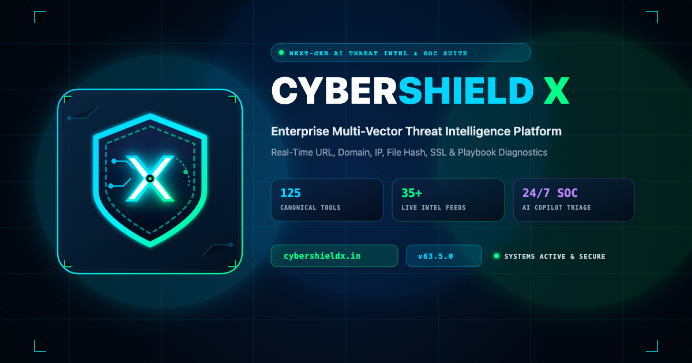

<p align="center">
  
</p>

<h1 align="center" style="font-family: 'Orbitron', sans-serif; font-size: 2.8rem; font-weight: 900; letter-spacing: 2px;">
  CYBERSHIELD X 🛡️
</h1>

<p align="center">
  <b>Next-Generation Autonomous Threat Intelligence, Interactive CyberSOC Workstation & Multi-Cloud Security Ecosystem</b>
</p>

<p align="center">
  <a href="https://www.cybershieldx.in"></a>
  <a href="https://cybershield-x.onrender.com/health"></a>
  <a href="https://www.cybershieldx.in/dashboard"></a>
  <a href="https://www.cybershieldx.in/terminal"></a>
  <br/>
  <a href="https://www.cybershieldx.in"></a>
  <a href="#testing"></a>
  <a href="https://search.google.com/search-console"></a>
  <a href="LICENSE"></a>
</p>

<p align="center">
  <a href="https://www.cybershieldx.in"><strong>🌐 Live Platform</strong></a> ·
  <a href="https://www.cybershieldx.in/terminal"><strong>💻 CyberSOC Terminal</strong></a> ·
  <a href="https://www.cybershieldx.in/team"><strong>👥 Core Team</strong></a> ·
  <a href="https://cybershield-x.onrender.com/health"><strong>⚡ Health Telemetry</strong></a> ·
  <a href="#architecture"><strong>📐 Architecture</strong></a> ·
  <a href="#tools-registry"><strong>🧰 Tools Registry</strong></a> ·
  <a href="#quickstart"><strong>🚀 Quickstart</strong></a> ·
  <a href="#contact"><strong>📬 Contact</strong></a>
</p>

---

## ⚡ Executive Summary

**CyberShield X** is a production-grade, enterprise cybersecurity operations platform engineered for Security Operations Centers (SOC), Red/Blue Teams, DevSecOps professionals, and security researchers.

Modern security workflows suffer from severe tool fragmentation: analysts are forced to juggle dozens of separate websites, CLI utilities, cloud consoles, and threat advisories. CyberShield X solves this by aggregating an authoritative **125-tool canonical security catalog across 24 domains**, an interactive **subprocess-sandboxed CyberSOC Terminal**, real-time **CISA Known Exploited Vulnerabilities (KEV) live streaming**, a resilient **dual-model AI Security Copilot (Google Gemini 2.5 Flash + Groq Qwen 27B)**, and a **multi-cloud event normalization fabric** into a unified, high-performance cyber command center.

> [!IMPORTANT]
> **Production Status (Phase 88 Certified)**: CyberShield X is active at **[cybershieldx.in](https://www.cybershieldx.in)**. The platform features the **Dashboard RGB Typewriter Animation**, **Google Gemini-Style Full-Pill Search Bar**, **Living Homepage Holographic Brand**, verified **RFC 9116 security.txt**, and strict **Cloudflare Full Strict TLS 1.3** protection.

```
┌────────────────────────────────────────────────────────────────────────┐
│                        CYBERSHIELD X AT A GLANCE                       │
├────────────────────────────────────────────────────────────────────────┤
│  • 125 Canonical Security Tools across 24 Specialized Domains          │
│  • Real-Time CISA KEV Live Exploit Stream with 15-Min Cache Proxy      │
│  • Subprocess-Sandboxed Interactive CyberSOC Terminal (/terminal)      │
│  • 7 Automated Multi-Vector Offensive & Defensive SOC Playbooks        │
│  • Resilient Dual-Model AI Copilot (Gemini 2.5 Flash ➔ Groq Qwen 27B)  │
│  • Normalized Multi-Cloud Ingestion (AWS CloudTrail, GCP, Azure Logs)  │
│  • Enterprise ITSM & SOAR Dispatch (Jira, ServiceNow, PagerDuty)       │
│  • RFC 6238 TOTP Google Authenticator + CyberPass Cryptographic Passkey│
│  • Full RFC 9116 security.txt, humans.txt & Google Console Verified    │
└────────────────────────────────────────────────────────────────────────┘
```

---

## 📡 Live Production Status & Topology

| Infrastructure Tier | Provider / Technology | Target / Endpoint | Production Status |
| :--- | :--- | :--- | :---: |
| **Global Edge Presentation** | Cloudflare Pages CDN | [`https://www.cybershieldx.in`](https://www.cybershieldx.in) | `HTTP/2 200 OK` 🟢 |
| **Global Backup Edge** | Cloudflare Pages Direct | [`https://cybershield-x.pages.dev`](https://cybershield-x.pages.dev) | `HTTP/2 200 OK` 🟢 |
| **Backend API Gateway** | Render Web Service | [`https://cybershield-x.onrender.com`](https://cybershield-x.onrender.com) | `HTTP 200 OK` 🟢 |
| **Health Telemetry** | Express Health Probe | [`/health`](https://cybershield-x.onrender.com/health) | `CONNECTED` 🟢 |
| **Database Cluster** | MongoDB Atlas | Multi-Region Replica Set (Mongoose 8) | `ACTIVE` 🟢 |
| **CISA KEV Threat Feed** | CISA Exploit Catalog API | `GET /api/threat-feed` (15-min cache) | `LIVE FEED` 🟢 |
| **CyberSOC Terminal** | Node.js Subprocess Sandbox | [`/terminal`](https://www.cybershieldx.in/terminal) (`shell: false`) | `ONLINE` 🟢 |
| **AI Security Copilot** | Gemini 2.5 Flash + Groq Qwen 27B | `POST /api/chatbot/chat` | `DUAL RESILIENT` 🟢 |
| **Google Search Console** | Googlebot Discovery | Meta tag verification + XML Sitemap | `VERIFIED` 🟢 |
| **Bing Webmaster Tools** | Microsoft Bingbot Discovery | `msvalidate.01` + `BingSiteAuth.xml` | `VERIFIED` 🟢 |
| **IndexNow Protocol** | Instant Multi-Engine Indexing | `d688ff842c7f4e9185a5601ee07a0494.txt` | `ACTIVE` 🟢 |
| **Vulnerability Disclosure** | RFC 9116 Standard | [`/.well-known/security.txt`](https://www.cybershieldx.in/.well-known/security.txt) | `COMPLIANT` 🟢 |

---

## 🌟 Core Platform Pillars & Phase 88 Innovations

### 1. 🧰 125 Canonical Security Tools across 24 Domains
An exhaustive, categorized directory of verified cybersecurity utilities:
* **55 Working Web Scanners**: Direct browser-based diagnostic platforms (Shodan, SSL Labs, MXToolbox, crt.sh, PacketTotal, CloudShark, FIRST EPSS, CISA KEV, URLScan, AlienVault OTX, TruffleHog, GitGuardian).
* **70 Coming Soon / Repository Tools**: Curated native and enterprise tools with direct references to official repositories and secure alternative guidance.
* **Dynamic Status Breakdown**: Dashboard header dynamically indicates exact live census: `125 tools available (55 Working Websites • 70 Coming Soon / Repository)`.

### 2. 💻 Sandboxed Interactive CyberSOC Terminal (`/terminal`)
A standalone, high-octane command-line workstation embedded directly in the browser:
* **Subprocess Security Model**: Invocations run via Node.js `child_process.spawn()` with `shell: false`. Shell metacharacters (`;`, `|`, `&`, `` ` ``, `$`, `>`, `<`, `\`) are neutralized to eliminate command injection.
* **10-Second Watchdog**: Automated timeout kill-switch prevents orphaned processes and memory exhaustion.
* **7 Pre-Built SOC Playbooks**: One-click automated workflows for Perimeter Recon, Web DAST, API Cryptography, Cloud DevSecOps, Threat Forensics, Phishing Defense, and AI Red-Teaming.

### 3. 🤖 Dual-Model Resilient CyberBot AI Copilot
* **Primary AI Engine**: Powered by Google Gemini 2.5 Flash for high-speed technical threat analysis, code review, and vulnerability remediation.
* **Automated Groq Fallback**: If Gemini encounters rate limits (HTTP 429) or transient spikes (HTTP 503), the orchestrator automatically cascades to **Groq Cloud (Qwen 27B)** in under 400ms.
* **Zero Leakage Security**: API keys, internal routes, and database models are permanently stripped from client responses.

### 4. 🎨 Phase 88 Living Cyber Experience
* **Dashboard RGB Typewriter**: Character-by-character streaming animation for `"Powerful Tools for a Safer Digital World"` with smooth chromatic RGB flowing light spectrum on `"Safer Digital World"`.
* **Google Gemini-Style Full-Pill Search Bar**: Circular full-pill design (`rounded-full`) with continuous multicolor animated border (`@keyframes geminiBorderShift`), keyboard quick-focus (`/`), and ambient cyber back-glow.
* **Living Homepage Brand**: Breathing neon glow on `"SHIELD"` and pulsing holographic emerald-cyan badge on `"X"`.

### 5. 🔐 Multi-Tier Zero-Trust Authentication
* **Universal 3-Way Login**: Seamless authentication via **Username**, **Email**, or **Phone Number**.
* **Google Authenticator TOTP (RFC 6238)**: Standard 6-digit rolling codes with ±30s clock drift tolerance.
* **CyberPass™ Passkey**: Zero-password cryptographic authentication derived from HMAC-SHA256 tokens.
* **Dual-Token JWT**: 15-minute cryptographically signed access tokens + 7-day refresh tokens with instant server-side revocation.

### 6. ☁️ Multi-Cloud Telemetry & SOAR Dispatch (Phases 80–81)
* **Cloud Telemetry Normalization**: Normalized log ingestion pipeline supporting **AWS CloudTrail**, **Google Cloud Audit**, and **Azure Activity Logs**.
* **Automated SOAR Routing**: Outbound webhook dispatcher with HMAC signatures connecting to **Jira**, **ServiceNow**, **PagerDuty**, **Slack**, and **Microsoft Teams**.

---

<a id="architecture"></a><a id="system-architecture"></a>
## 📐 System Architecture

CyberShield X follows a decoupled client-server architecture with strict separation of concerns, the Repository Pattern, and defense-in-depth isolation:

```
┌────────────────────────────────────────────────────────────────────────┐
│                      Global Edge Tier (Cloudflare)                     │
│        https://www.cybershieldx.in • https://cybershield-x.pages.dev   │
│                 Full Strict TLS 1.3 • Global Anycast Edge              │
└───────────────────────────────────┬────────────────────────────────────┘
                                    │ HTTPS / WSS
                                    ▼
┌────────────────────────────────────────────────────────────────────────┐
│                    Frontend Tier (React 18 SPA)                        │
│  • HomePage: CISA KEV Live Marquee, Matrix Rain, Living Brand Lockup   │
│  • Dashboard: 125 Canonical Tool Cards, Gemini Search Bar, RGB Typing  │
│  • CyberSOC Terminal: Subprocess-Sandboxed Console (/terminal)         │
│  • CyberBot Copilot: Dual-Model AI (Gemini 2.5 Flash + Groq Qwen 27B)  │
│  • Mobile & PWA: Capacitor iOS/Android + Offline Service Worker        │
└───────────────────────────────────┬────────────────────────────────────┘
                                    │ REST API over TLS / Socket.IO
                                    ▼
┌────────────────────────────────────────────────────────────────────────┐
│             Backend API Tier (Node.js Express on Render)               │
│  • Security Perimeter: Helmet, Strict CORS, SSRF DNS-Pinning, CSP      │
│  • Modular Controllers: auth, threatFeed, terminal, chatbot, audit     │
│  • Terminal Sandbox: child_process.spawn(shell: false) + 10s Watchdog  │
│  • In-Memory Keep-Alive: 9-minute automated health heartbeat           │
└───────────────────────────────────┬────────────────────────────────────┘
                                    │ TLS 1.3 Mongoose ODM
                                    ▼
┌────────────────────────────────────────────────────────────────────────┐
│                   Data & External Intelligence Tier                    │
│  • MongoDB Atlas: Multi-Tenant Schemas, AES-256 Encrypted Fields       │
│  • CISA KEV Catalog: Automated Exploit Feed with 15-Minute Cache Proxy │
│  • Google Gemini & Groq Cloud: Multi-Model AI Redundancy Cascade       │
│  • Enterprise ITSM: Jira, ServiceNow, PagerDuty, Slack, Teams Webhooks │
└────────────────────────────────────────────────────────────────────────┘
```

---

<a id="tools-registry"></a><a id="tools"></a>
## 🧰 125 Canonical Security Tools / 24 Domains

> [!NOTE]
> The full interactive directory is browsable on the homepage and dashboard at [cybershieldx.in/dashboard](https://www.cybershieldx.in/dashboard).

| # | Operational Security Domain | Tools | Featured Tools & Reference Platforms |
| :---: | :--- | :---: | :--- |
| **01** | **Reconnaissance & OSINT** | 9 | DNS Enumeration, WHOIS Engine, Subdomain Finder, Shodan Search, theHarvester, Sherlock, Amass, crt.sh |
| **02** | **DNS & Network Intelligence** | 8 | DNS Propagation, Reverse DNS, MX Lookup, Traceroute, ASN Lookup, PacketTotal, CloudShark |
| **03** | **Web & DAST Security** | 8 | Port Scanner, Service Fingerprinting, HTTP Header Auditor, SSL/TLS Handshake, Nikto, OWASP ZAP |
| **04** | **Vulnerability Assessment** | 10 | CVE Inspector, SQLmap, Trivy, WPScan, Nuclei, OpenVAS, CISA KEV Catalog, FIRST EPSS |
| **05** | **Threat Intelligence** | 8 | URL Threat Intel, Dark Web Breach Checker, AlienVault OTX, abuse.ch MalwareBazaar, urlscan.io |
| **06** | **Search Engine & OSINT Dorking** | 4 | Google Dorking Engine, Public Leak Database, Metadata Inspector, Email Breach Explorer |
| **07** | **Cloud Security & Posture** | 4 | Prowler AWS CIS Benchmark, Scout Suite Multi-Cloud, S3 Bucket Finder, Cloud IAM Linter |
| **08** | **API Security & Cryptography** | 4 | Postman Security Auditor, JWT Entropy Auditor, API Endpoint Fuzzer, Swagger Spec Linter |
| **09** | **Authentication & Identity** | 4 | Hydra Protocol Auditor, LDAP Policy Auditor, SAML Security Decoder, OAuth 2.0 Validator |
| **10** | **Mobile AppSec (iOS & Android)** | 4 | MobSF Android Manifest, iOS IPA Binary Validator, APK Secrets Extractor, Androguard |
| **11** | **Container & Kubernetes** | 4 | Kube-Bench CIS, Kubesec Pod Linter, Docker CIS Benchmark, Falco Runtime Syscall Inspector |
| **12** | **DevSecOps / Supply Chain** | 7 | Semgrep SAST, Gitleaks, Dependency-Track SBOM, Snyk, GitGuardian, TruffleHog, OSV DB |
| **13** | **Malware Analysis & Reversing** | 5 | YARA Pattern Matcher, PE Header Analyzer, Cuckoo Sandbox, PDF Document Inspector, Strings |
| **14** | **Digital Forensics & Incident Response** | 6 | Autopsy Forensics, Volatility Memory Analysis, Sleuth Kit, Plaso, ExifTool, Aperi'Solve |
| **15** | **Binary Analysis & Firmware** | 4 | Ghidra Headless Decompiler, Radare2 Shellcode Inspector, Binwalk Firmware, Capstone |
| **16** | **Wireless Security** | 4 | Aircrack-ng Suite, Kismet Wireless Survey, Wifite Audit Interface, BLE Scanner |
| **17** | **Email Security & Anti-Spoofing** | 3 | DMARC/SPF/DKIM Validator, MX Blacklist Auditor, Email Hop Analyzer |
| **18** | **Social Engineering Defense** | 4 | GoPhish Simulator, Domain Typosquatting Analyzer, Evilginx Guard, Behavioral Profiler |
| **19** | **AI & LLM Security** | 4 | Prompt Injection Guard, Garak LLM Vulnerability Scanner, AI Adversarial Red-Team |
| **20** | **Privacy & Data Protection** | 3 | GDPR Cookie Auditor, Sensitive PII Scanner, Compliance Roadmap Planner |
| **21** | **Incident Management & SOC** | 4 | TheHive Incident Manager, MISP Threat Publisher, SOC Playbook Orchestrator |
| **22** | **Security Monitoring & SIEM** | 3 | Wazuh SIEM Connector, Zeek Transaction Parser, Suricata NIDS Rule Tester |
| **23** | **Compliance & Governance** | 3 | SOC 2 Posture Evaluator, HIPAA ePHI Auditor, PCI-DSS Assessment Assistant |
| **24** | **Utilities & Cryptographic Codecs** | 8 | JWT Inspector, Base64 Codec, Hash Identifier, Perceptual Image Hash (pHash), CIDR Math |

---

<a id="team"></a><a id="core-team"></a>
## 👥 Core Team & Leadership

CyberShield X is architected and actively maintained by a dedicated team of cybersecurity analysts, AI researchers, and systems engineers:

<p align="center">
  <a href="https://www.cybershieldx.in/team">
    
  </a>
</p>

| Team Member | Official Role | Clearance | Operational Focus | Status |
| :--- | :--- | :---: | :--- | :---: |
| **Anil Kumar** | **Founder & Cybersecurity Analyst** | `FOUNDER & LEAD` | **Platform Architecture, Threat Intelligence & Core Engineering** | `ONLINE` 🟢 |
| **Suryansh** | Data Analyst | `CORE SPECIALIST` | Threat Data Pipelines & Telemetry Normalization | `ONLINE` 🟢 |
| **Aryan Patel** | AI & Machine Learning | `CORE SPECIALIST` | Multi-Model Copilot, LLM Security & Adversarial Testing | `ONLINE` 🟢 |
| **Pranav** | Data Analyst | `CORE SPECIALIST` | Security Metrics, Reporting Dashboards & Data Analytics | `ONLINE` 🟢 |
| **Ankita** | Network Analyst | `CORE SPECIALIST` | Network Security, Packet Telemetry & Perimeter Defense | `ONLINE` 🟢 |
| **Sushant** | Data Analyst | `CORE SPECIALIST` | Cloud Telemetry (AWS/GCP/Azure) & Threat Correlation | `ONLINE` 🟢 |

* **Founder & Lead Architect**: **Anil Kumar**
* **Official Team Hub**: [https://www.cybershieldx.in/team](https://www.cybershieldx.in/team)
* **Direct Communications**: [official.cybershieldx@gmail.com](mailto:official.cybershieldx@gmail.com)

---

## 🔒 Defense-in-Depth Security Blueprint

| Layer | Security Control | Technical Implementation |
| :--- | :--- | :--- |
| **Edge & Transport** | Full Strict TLS 1.3 | Cloudflare Edge with HSTS (`max-age=31536000; includeSubDomains; preload`) and DNSSEC. |
| **Security Headers** | Comprehensive `_headers` | `X-Frame-Options: DENY`, `X-Content-Type-Options: nosniff`, `Permissions-Policy`, `COOP: same-origin`, `CORP: same-site`. |
| **Content Security** | Hardened CSP | `default-src 'self'`, `frame-ancestors 'none'`, `base-uri 'self'`, `form-action 'self'`, strictly allowlisted API endpoints. |
| **Vulnerability Policy**| RFC 9116 Compliant | Published at `https://www.cybershieldx.in/.well-known/security.txt` with PGP key and disclosure terms. |
| **Developer Credits** | RFC `humans.txt` | Standard credits file at `/.well-known/humans.txt` linked in `<head>`. |
| **CORS Isolation** | Origin Gating | Strictly matches `https://www.cybershieldx.in` and `https://*.pages.dev`. Rejects unauthorized cross-origin requests. |
| **Subprocess Sandbox** | Native Spawn Isolation | `child_process.spawn(cmd, args, { shell: false })`. Shell metacharacters are rejected outright with a 10s watchdog. |
| **SSRF Prevention** | DNS-Pinning Outbound Agents | Validates resolved IP addresses before request dispatch. Strictly blocks RFC 1918 private spaces and cloud metadata IP (`169.254.169.254`). |
| **Identity Protection**| Multi-Factor Authentication | Dual-Token JWT (15-min access / 7-day refresh), RFC 6238 TOTP, and HMAC-signed CyberPass passkeys. |
| **Data Encryption** | Field-Level Vault | Sensitive user tokens and audit data encrypted at rest via authenticated AES-256-GCM. |

---

<a id="quickstart"></a>
## 🚀 Quickstart & Local Development

### 1. Prerequisites
* **Node.js**: `v18.x` or `v20.x` LTS
* **npm**: `v9.x` or `v10.x`
* **MongoDB**: Local Community Server (`mongodb://127.0.0.1:27017/cybershield`) or a MongoDB Atlas URI

### 2. Installation
```bash
# 1. Clone the repository
git clone https://github.com/Kumar11rudra/CYBERSHIELD-X.git
cd CYBERSHIELD-X

# 2. Install all dependencies across root, server, and client
npm run install:all
```

### 3. Environment Configuration
```bash
cp server/.env.example server/.env
```
Populate the core variables in `server/.env`:
```ini
PORT=3001
NODE_ENV=development
MONGO_URI=mongodb://127.0.0.1:27017/cybershield
JWT_SECRET=your_at_least_64_character_ultra_secure_jwt_secret_key_here
CLIENT_URL=http://localhost:3000
SCAN_HMAC_KEY=your_hmac_signing_key_here
GEMINI_API_KEY=your_optional_gemini_api_key
GROQ_API_KEY=your_optional_groq_api_key
```

### 4. Launch Local Development Environment
```bash
# Concurrently starts Express backend (Port 3001) & React client (Port 3000)
npm run dev
```
Open **[http://localhost:3000](http://localhost:3000)** in your browser.

---

## 📋 Environment Variables Reference

| Variable | Scope | Required | Default / Description |
| :--- | :---: | :---: | :--- |
| `PORT` | Server | No | Port number for Express API (default: `3001` or `5001`) |
| `NODE_ENV` | Server | Yes | Runtime environment (`development`, `test`, `production`) |
| `MONGO_URI` | Server | Yes | MongoDB Atlas connection string URI |
| `JWT_SECRET` | Server | Yes | Minimum 64-character secret key for signing access tokens |
| `CLIENT_URL` | Server | Yes | Allowed frontend origin for CORS (e.g. `https://www.cybershieldx.in`) |
| `SCAN_HMAC_KEY` | Server | Yes | Secret key for signing report tamper-detection fingerprints |
| `GEMINI_API_KEY` | Server | Optional | Google Gemini 2.5 Flash API key (cascades to fallback if omitted) |
| `GROQ_API_KEY` | Server | Optional | Groq API key (Qwen 27B fallback model) |
| `ADMIN_EMAIL` | Server | Optional | Default admin email for database seeding |
| `ADMIN_USERNAME` | Server | Optional | Default admin username for database seeding |
| `ADMIN_PASSWORD` | Server | Optional | Default admin password for local development seed |
| `REACT_APP_API_URL` | Client | Optional | Custom backend API base URL (defaults to production backend) |

---

<a id="testing"></a>
## 🧪 Testing & Verification

All quality gates are 100% green across frontend and backend suites:

```bash
# ─── 1. Run Complete Client Test Battery (18 Suites, 157 Tests) ───────────
CI=true npm --prefix client test -- --watchAll=false

# ─── 2. Compile Production Frontend Bundle (Zero Warnings as Errors) ──────
npm --prefix client run build

# ─── 3. Run Server Core Test Suites ──────────────────────────────────────
npm --prefix server test -- tests/canonical_125_tool_registry.test.js tests/cyberpass_authentication.test.js tests/threatFeed.test.js

# ─── 4. Run Automated Production Release Verification ────────────────────
npm run verify:release
```

* **Client Test Pass Rate**: `157 / 157 tests (100% PASS across all 18 suites)`
* **Production Build**: `Exit Code 0` (Clean bundle, zero circular dependencies)
* **Release Verification**: `READY_FOR_RELEASE` (Exit Code 0)

---

## 🌐 Authoritative REST API Reference

> **Production API Base**: `https://cybershield-x.onrender.com`

| Method | Endpoint | Description | Access Tier |
| :---: | :--- | :--- | :---: |
| `GET` | `/health` | Real-time platform and database health telemetry | Public |
| `POST` | `/api/auth/register` | Register a new operator account | Public |
| `POST` | `/api/auth/login` | Universal 3-way login (returns JWT pair) | Public |
| `POST` | `/api/auth/cyberpass/login` | Cryptographic passkey / QR badge authentication | Public |
| `POST` | `/api/auth/refresh` | Issue fresh 15-minute access token | Refresh Token |
| `GET` | `/api/threat-feed` | Live CISA Known Exploited Vulnerabilities feed (15m cached) | Public |
| `POST` | `/api/chatbot/chat` | Dual-Model AI Security Copilot query | Public / JWT |
| `POST` | `/api/terminal/execute` | Execute allowlisted diagnostic binary in sandbox | JWT + Role |
| `POST` | `/api/terminal/cancel` | Emergency abort signal for running terminal command | JWT + Role |
| `GET` | `/api/observability/health` | Comprehensive multi-subsystem reliability snapshot | Admin |
| `POST` | `/api/cloud-ingestion/aws/cloudtrail` | Ingest and normalize AWS CloudTrail audit events | API Key |

---

## 🤝 Contributing

We welcome contributions from the cybersecurity and open-source community! Please review our **[CONTRIBUTING.md](CONTRIBUTING.md)** guidelines prior to submitting pull requests.

1. Fork the repository
2. Create your feature branch (`git checkout -b feat/advanced-recon-scanner`)
3. Commit your changes using conventional commits (`git commit -m "feat(scanner): add SSL cipher suite auditor"`)
4. Verify all tests pass (`npm run build && npm --prefix client test -- --watchAll=false`)
5. Push to the branch and open a Pull Request

---

## 🔒 Responsible Security Disclosure

Security is our foremost priority. If you identify a security vulnerability in CyberShield X, please adhere to responsible disclosure practices:

* **Official Security Email**: [official.cybershieldx@gmail.com](mailto:official.cybershieldx@gmail.com)
* **GitHub Security Advisory**: [Open Private Advisory](https://github.com/Kumar11rudra/CYBERSHIELD-X/security/advisories/new)
* **Security Policy**: Detailed in [SECURITY.md](SECURITY.md) and [RFC 9116 security.txt](https://www.cybershieldx.in/.well-known/security.txt)
* **Response Commitment**: Initial acknowledgement within **48 hours**; high-severity patches deployed within **14 business days**.
* **Zero Public Exploits**: Please do not open public GitHub issues or post reproduction scripts publicly prior to patch deployment.

---

## 📄 MIT License

CyberShield X is open-source software licensed under the **[MIT License](LICENSE)**.

```
MIT License

Copyright (c) 2026 Anil Kumar — CyberShield X Core Team

Permission is hereby granted, free of charge, to any person obtaining a copy
of this software and associated documentation files (the "Software"), to deal
in the Software without restriction, including without limitation the rights
to use, copy, modify, merge, publish, distribute, sublicense, and/or sell
copies of the Software, and to permit persons to whom the Software is
furnished to do so, subject to the following conditions:

The above copyright notice and this permission notice shall be included in all
copies or substantial portions of the Software.

THE SOFTWARE IS PROVIDED "AS IS", WITHOUT WARRANTY OF ANY KIND, EXPRESS OR
IMPLIED, INCLUDING BUT NOT LIMITED TO THE WARRANTIES OF MERCHANTABILITY,
FITNESS FOR A PARTICULAR PURPOSE AND NONINFRINGEMENT. IN NO EVENT SHALL THE
AUTHORS OR COPYRIGHT HOLDERS BE LIABLE FOR ANY CLAIM, DAMAGES OR OTHER
LIABILITY, WHETHER IN AN ACTION OF CONTRACT, TORT OR OTHERWISE, ARISING FROM,
OUT OF OR IN CONNECTION WITH THE SOFTWARE OR THE USE OR OTHER DEALINGS IN THE
SOFTWARE.
```

---

## ⚠️ Legal & Ethical Notice

> [!CAUTION]
> **CyberShield X is engineered strictly for authorized security research, defense, education, and certified penetration testing.**
>
> * All diagnostic capabilities, scanners, and playbooks must be executed **solely against infrastructure you own or have explicit written permission to assess**.
> * Unauthorized port scanning, vulnerability probing, or interception against third-party networks without authorization is **illegal** under international computer misuse laws (including the U.S. CFAA, EU NIS2, and the Indian Information Technology Act 2000).
> * The maintainers, contributors, and Anil Kumar assume **zero liability** for misuse or damages resulting from the use of this software.
>
> **Defend fearlessly. Operate ethically. Protect the digital frontier.**

---

<a id="contact"></a>
## 📬 Contact & Communications

| Channel | Destination | Description |
| :--- | :--- | :--- |
| **🌐 Production Platform** | [https://www.cybershieldx.in](https://www.cybershieldx.in) | Live CyberShield X command center |
| **📧 Direct Communications** | [official.cybershieldx@gmail.com](mailto:official.cybershieldx@gmail.com) | Core inquiries & partnerships |
| **👥 Core Team Workstation** | [https://www.cybershieldx.in/team](https://www.cybershieldx.in/team) | Team roster & operational profiles |
| **🐙 Official Repository** | [Kumar11rudra/CYBERSHIELD-X](https://github.com/Kumar11rudra/CYBERSHIELD-X) | Source code, issues & releases |
| **👤 Founder & Lead** | **Anil Kumar** | Founder & Cybersecurity Analyst |

---

<p align="center">
  Built with ❤️ by the <strong>CyberShield X Team</strong> · Deployed globally at <a href="https://www.cybershieldx.in">cybershieldx.in</a>
  <br/>
  <sub>CyberShield X Platform · Version v63.5.0 Production · Certified 2026 · All Rights Reserved</sub>
</p>
